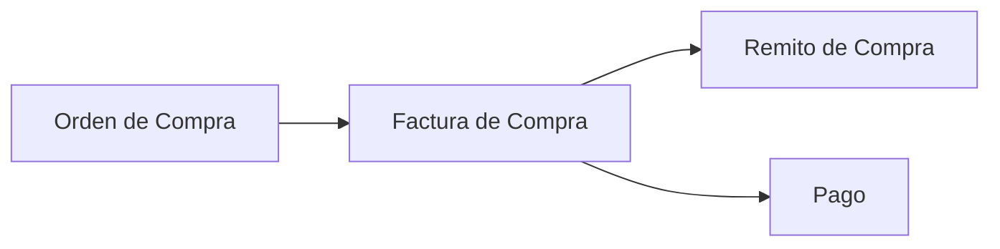

## Para qué sirve

El módulo de **Compras** cubre el circuito de abastecimiento, desde la orden de compra hasta el pago al proveedor, pasando por la factura de compra y la recepción de mercadería. Todos los documentos quedan **vinculados entre sí** y son navegables desde la cadena de documentos.

## Circuito

El circuito es **lineal y trazable**: la factura de compra nace de la OC confirmada y el remito de compra nace de la factura confirmada. El **remito es el único que ingresa stock**; la factura actualiza la cuenta corriente del proveedor y habilita el pago.

## Documentos

| Documento | Categoría | Para qué |
|---|---|---|
| **Orden de Compra** | `ORDER` (compra) | Solicitud al proveedor. |
| **Factura de Compra** | `INVOICE` | Factura del proveedor; genera el remito y el pago. |
| **Remito de Compra** | `REMITO` | Recepción de mercadería; da entrada de stock. |
| **Nota de Crédito / Débito** | `CREDIT_NOTE` / `DEBIT_NOTE` | Ajustes sobre la factura. |
| **Pago** | — | Pago al proveedor (Tesorería). |

## Trazabilidad

- Cada comprobante muestra la **cadena de documentos** (*Origen* → *Actual* → *Generado*) con enlaces a cada eslabón. Los enlaces respetan la categoría del documento y tus permisos: si no podés abrir un tipo de documento, aparece indicado con un candado en lugar de un enlace.
- Desde la vista de cada documento aparecen las acciones para **crear o abrir el siguiente**:
  - OC confirmada → **Crear Factura** / **Ver factura**.
  - Factura de compra confirmada → **Crear remito** / **Ver remito**.
  - Factura de compra confirmada → **Crear NC** y **Crear ND**.
- El backend **valida el circuito**: no se pueden saltar pasos (una factura exige OC confirmada; un remito exige factura confirmada) ni duplicar facturas o remitos activos para el mismo documento de origen.

## Resumen y listado de comprobantes

En **Compras → Resumen** (`/erp/purchases`) podés consultar la actividad de los últimos 7, 30 o 90 días: indicadores de facturas confirmadas, órdenes y remitos; un gráfico de líneas que compara por día facturas, notas de crédito/débito, órdenes y remitos de compra; e importe neto confirmado separado por moneda. Los importes consideran únicamente comprobantes confirmados e incluyen notas de crédito y débito; para revisar estados operativos y saldos, usá los módulos correspondientes.

El listado único está en **Compras → Comprobantes** (`/erp/purchases/comprobantes`).

En **Compras → Comprobantes** (`/erp/purchases/comprobantes`) se listan juntos órdenes, facturas, remitos y notas, con filtro por categoría y estado. Los enlaces anteriores con `?category=` siguen redirigiendo al listado filtrado. Al abrir un registro, cada uno lleva a su **vista específica**: las órdenes a `/erp/purchases/orders/{id}`, los remitos a `/erp/purchases/remitos/{id}` y facturas y notas a `/erp/purchases/purchases-documents/{id}`.

En **Comprobantes**, elegí **Tipo de documento** y **Estado** en los selectores superiores. En los listados de **Órdenes de Compra** y **Remitos de Compra**, usá **Filtros** en la tabla y agregá una condición sobre **Estado**. Para consultar anulados, activá **Mostrar anulados** o elegí *Anulada* en el filtro de estado.

Los **saldos iniciales** de cuentas corrientes no aparecen en este listado porque se administran desde la cuenta corriente y no son comprobantes de compra.

En los listados de comprobantes, órdenes y remitos de compra, podés abrir cada documento haciendo clic en cualquier parte de su fila. Los botones y enlaces propios de la fila conservan su acción.

Al abrir un comprobante y volver al listado se conservan la búsqueda, los filtros de tabla, el orden, la página y la posición de scroll. En los formularios, el buscador de proveedores permite encontrar registros antiguos por nombre, razón social, CUIT o correo.

En la ficha de cada comprobante podés usar **Alt + M** para editar, **Alt + I** para imprimir y **Alt + C** para abrir la confirmación cuando la acción esté disponible. En las facturas con saldo pendiente, **Alt + P** abre el registro del pago. Al pasar el cursor o enfocar un botón, la ayuda muestra su atajo; confirmar siempre muestra primero el diálogo de revisión.

La **referencia** cargada en el comprobante aparece destacada debajo de los datos principales de la ficha para identificarlo rápidamente.

En el detalle de órdenes, remitos, facturas y notas, hacé clic en el nombre de un producto para abrir su ficha. Los productos libres, sin ficha asociada, se muestran como texto.

El botón **Crear nuevo comprobante** está disponible en el listado general y también en los listados de órdenes y remitos. Desde cualquiera de ellos se puede iniciar una orden de compra, factura, remito o nota de crédito/débito. El botón muestra **Alt + N**, que abre el menú. En el formulario, **F2** abre el selector de productos, **Tab** recorre los campos, **Ctrl + Enter** agrega los productos seleccionados y **Ctrl + S** guarda. Podés filtrar por categorías y etiquetas, seleccionar varios artículos y agregarlos juntos; cada uno comienza con cantidad 1 y luego podés modificarla en su renglón. Si elegís varias categorías o etiquetas, el producto debe coincidir con al menos una opción de cada filtro activo. Las opciones se muestran según los permisos de creación del usuario.

## Páginas de esta sección

- [Órdenes de compra](/procesos/compras/ordenes-de-compra/)
- [Recepciones](/procesos/compras/recepciones/)
- [Facturas de compra](/procesos/compras/facturas-de-compra/)
- [Pagos](/procesos/compras/pagos/)
- [Importadores](/procesos/compras/importadores/)

## Permisos necesarios

:::note[Permisos necesarios]
- Ver compras · Crear compras · Editar compras · Confirmar compras · Cancelar compras · Eliminar compras
- Además existen permisos por tipo de documento (órdenes de compra, facturas, remitos, notas de crédito/débito), p. ej. *Crear facturas de compras* o *Crear remitos de compras*.
:::

## Ver también

- [Contrapartes](/configuracion/contrapartes/) — proveedores.
- [Depósitos y ubicaciones](/configuracion/depositos-ubicaciones/).
