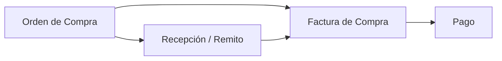

## Para qué sirve

El módulo de **Compras** cubre el circuito de abastecimiento, desde la orden de compra hasta el pago al proveedor, pasando por la recepción de mercadería y la factura de compra.

## Circuito

## Documentos

| Documento | Categoría | Para qué |
|---|---|---|
| **Orden de Compra** | `ORDER` (compra) | Solicitud al proveedor. |
| **Remito de Compra** | `REMITO` | Recepción de mercadería; da entrada de stock. |
| **Comprobante de Compra** | `INVOICE` | Factura del proveedor. |
| **Nota de Crédito / Débito** | `CREDIT_NOTE` / `DEBIT_NOTE` | Ajustes sobre la factura. |
| **Pago** | — | Pago al proveedor (Tesorería). |

## Páginas de esta sección

- [Órdenes de compra](/procesos/compras/ordenes-de-compra/)
- [Recepciones](/procesos/compras/recepciones/)
- [Facturas de compra](/procesos/compras/facturas-de-compra/)
- [Pagos](/procesos/compras/pagos/)

## Permisos necesarios

:::note[Permisos necesarios]
- Ver compras · Crear compras · Editar compras · Confirmar compras · Anular compras · Eliminar compras
- Además existen permisos por tipo de documento (órdenes de compra, facturas, remitos, notas de crédito/débito).
:::

## Ver también

- [Contrapartes](/configuracion/contrapartes/) — proveedores.
- [Depósitos y ubicaciones](/configuracion/depositos-ubicaciones/).
