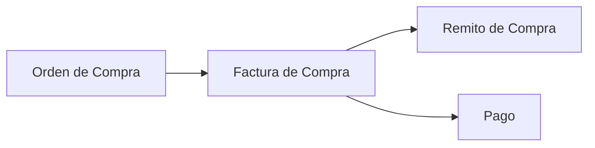

## Para qué sirve

El módulo de **Compras** cubre el circuito de abastecimiento, desde la orden de compra hasta el pago al proveedor, pasando por la factura de compra y la recepción de mercadería. Todos los documentos quedan **vinculados entre sí** y son navegables desde la cadena de documentos.

## Circuito

El circuito es **lineal y trazable**: la factura de compra nace de la OC confirmada y el remito de compra nace de la factura confirmada. El **remito es el único que ingresa stock**; la factura actualiza la cuenta corriente del proveedor y habilita el pago.

## Documentos

| Documento | Categoría | Para qué |
|---|---|---|
| **Orden de Compra** | `ORDER` (compra) | Solicitud al proveedor. |
| **Factura de Compra** | `INVOICE` | Factura del proveedor; genera el remito y el pago. |
| **Remito de Compra** | `REMITO` | Recepción de mercadería; da entrada de stock. |
| **Nota de Crédito / Débito** | `CREDIT_NOTE` / `DEBIT_NOTE` | Ajustes sobre la factura. |
| **Pago** | — | Pago al proveedor (Tesorería). |

## Trazabilidad

- Cada comprobante muestra la **cadena de documentos** (*Origen* → *Actual* → *Generado*) con enlaces a cada eslabón. Los enlaces respetan la categoría del documento y tus permisos: si no podés abrir un tipo de documento, aparece indicado con un candado en lugar de un enlace.
- Desde la vista de cada documento aparecen las acciones para **crear o abrir el siguiente**:
  - OC confirmada → **Crear Factura** / **Ver factura**.
  - Factura de compra confirmada → **Crear remito** / **Ver remito**.
  - Factura de compra confirmada → **Crear NC** y **Crear ND**.
- El backend **valida el circuito**: no se pueden saltar pasos (una factura exige OC confirmada; un remito exige factura confirmada) ni duplicar facturas o remitos activos para el mismo documento de origen.

## Listado único de comprobantes

En **Compras → Comprobantes** (`/erp/purchases`) se listan juntos órdenes, facturas, remitos y notas, con filtro por categoría y estado. Al abrir un registro, cada uno lleva a su **vista específica**: las órdenes a `/erp/purchases/orders/{id}`, los remitos a `/erp/purchases/remitos/{id}` y facturas y notas a `/erp/purchases/purchases-documents/{id}`.

## Páginas de esta sección

- [Órdenes de compra](/procesos/compras/ordenes-de-compra/)
- [Recepciones](/procesos/compras/recepciones/)
- [Facturas de compra](/procesos/compras/facturas-de-compra/)
- [Pagos](/procesos/compras/pagos/)
- [Importadores](/procesos/compras/importadores/)

## Permisos necesarios

:::note[Permisos necesarios]
- Ver compras · Crear compras · Editar compras · Confirmar compras · Cancelar compras · Eliminar compras
- Además existen permisos por tipo de documento (órdenes de compra, facturas, remitos, notas de crédito/débito), p. ej. *Crear facturas de compras* o *Crear remitos de compras*.
:::

## Ver también

- [Contrapartes](/configuracion/contrapartes/) — proveedores.
- [Depósitos y ubicaciones](/configuracion/depositos-ubicaciones/).
