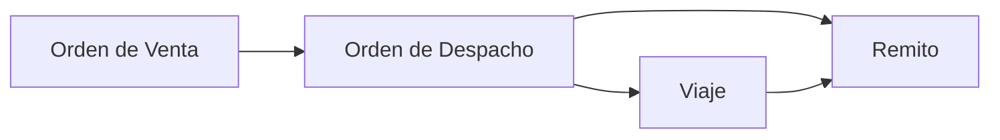

## Para qué sirve

El módulo de **Logística** planifica y ejecuta el transporte de la mercadería: órdenes de despacho, viajes, corredores, flota (vehículos y choferes) y mantenimiento.

## Circuito

## Componentes

- **Órdenes de despacho** — pedidos a despachar.
- **Viajes** — planificación y seguimiento del transporte.
- **Corredores** — rutas predefinidas.
- **Flota** — vehículos, combinaciones y choferes.
- **Tarifas** — costos de transporte.
- **Mantenimiento** — órdenes, planes y cubiertas.

## Páginas de esta sección

- [Viajes](/procesos/logistica/viajes/)
- [Órdenes de despacho](/procesos/logistica/ordenes-de-despacho/)
- [Implementación de Logística](/procesos/logistica/implementacion/) — guía de prueba y capacitación.

## Permisos necesarios

:::note[Permisos necesarios]
- Viajes: Ver viajes · Crear viajes · Editar viajes · Eliminar viajes
- Despachos: Ver/Crear/Editar/Eliminar órdenes de despacho
- Corredores, choferes, vehículos y tarifas de transferencia: permisos propios por módulo
:::

## Ver también

- [Ventas](/procesos/ventas/) y [Remitos de venta](/procesos/ventas/remitos/).
- [Depósitos y ubicaciones](/configuracion/depositos-ubicaciones/).
