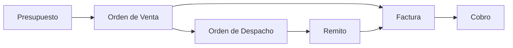

## Para qué sirve

El módulo de **Ventas** cubre el circuito comercial completo, desde el presupuesto hasta el cobro, pasando por la orden de venta, el remito y la factura.

## Circuito

## Documentos

| Documento | Categoría | Para qué |
|---|---|---|
| **Presupuesto** | `QUOTE` | Oferta al cliente, con validez. |
| **Orden de Venta** | `ORDER` | Compromiso de venta; dispara preparación y despacho. |
| **Orden de Despacho** | (logística) | Planificación del envío. |
| **Remito** | `REMITO` | Entrega de mercadería. |
| **Factura** | `INVOICE` | Comprobante fiscal. |
| **Nota de Crédito / Débito** | `CREDIT_NOTE` / `DEBIT_NOTE` | Ajustes sobre facturas. |
| **Recibo** | `RECEIPT` | Constancia de cobro. |

## Resumen y comprobantes

En **Ventas → Resumen** (`/erp/sales`) podés consultar la actividad de los últimos 7, 30 o 90 días: indicadores de facturas confirmadas, presupuestos y órdenes; un gráfico de líneas que compara por día facturas, notas de crédito/débito, presupuestos, órdenes y remitos; e importe neto confirmado separado por moneda. Los importes consideran únicamente comprobantes confirmados e incluyen notas de crédito y débito; los estados operativos completos se consultan en cada listado.

El listado combinado está en **Ventas → Comprobantes** (`/erp/sales/comprobantes`). Reúne los comprobantes de venta y permite filtrar por categoría y estado. En **Todos**, el filtro avanzado **Estado** identifica cada opción por tipo de comprobante (por ejemplo, *Factura · Pendiente* u *Orden de venta · Lista para despacho*); al seleccionar una categoría, muestra sus estados sin prefijo. Los enlaces anteriores con `?category=` siguen redirigiendo al listado filtrado.

En los listados de presupuestos, órdenes de venta, remitos y comprobantes, podés abrir el documento haciendo clic en cualquier parte de su fila. Los botones y enlaces propios de la fila conservan su acción. Al volver con la navegación del navegador se restaura la posición del listado y, en comprobantes, la categoría que estabas consultando.

Al abrir un comprobante y volver al listado se conservan la búsqueda, los filtros de tabla, el orden, la página y la posición de scroll. En los formularios, el buscador de clientes permite encontrar registros antiguos por nombre, razón social, CUIT o correo.

En la ficha de cada comprobante podés usar **Alt + M** para editar, **Alt + I** para imprimir y **Alt + C** para abrir la confirmación cuando la acción esté disponible. En una OV o factura con saldo pendiente, **Alt + P** abre el registro del cobro. Al pasar el cursor o enfocar un botón, la ayuda muestra su atajo; confirmar siempre muestra primero el diálogo de revisión.

La **referencia** cargada en el comprobante aparece destacada debajo de los datos principales de la ficha para identificarlo rápidamente.

## Crear comprobantes desde cualquier listado

El botón **Crear nuevo comprobante** aparece en **Ventas → Comprobantes** (`/erp/sales/comprobantes`) y en los listados de **Presupuestos** (`/erp/budgets`), **Órdenes de Venta** (`/erp/orders`) y **Remitos** (`/erp/remitos`). Permite iniciar cualquiera de esos comprobantes, una factura o una nota de crédito/débito sin importar desde cuál listado lo abriste. El botón muestra **Alt + N**, que abre el menú. En los formularios, los atajos se muestran junto a su acción: **F2** abre el selector de productos, **Tab** recorre los campos, **Ctrl + Enter** agrega el producto y **Ctrl + S** guarda. Las opciones disponibles respetan los permisos de creación de cada tipo.

## Páginas de esta sección

- [Presupuestos](/procesos/ventas/presupuestos/)
- [Crear una Orden de Venta](/procesos/ventas/crear-orden-de-venta/)
- [Remitos de venta](/procesos/ventas/remitos/)
- [Facturación](/procesos/ventas/facturacion/)
- [Cobros](/procesos/ventas/cobros/)
- [Mis ventas y reportes](/procesos/ventas/mis-ventas/)
- [Circuito de ventas](/procesos/ventas/circuito-de-ventas/) — configuración

## Permisos necesarios

:::note[Permisos necesarios]
- Ver ventas · Crear ventas · Editar ventas · Confirmar ventas · Anular ventas · Eliminar ventas
- Además existen permisos por tipo de documento (presupuestos, órdenes de venta, facturas, remitos, notas de crédito/débito), que permiten un control más fino.
- **Ver precios, totales y comisiones de órdenes de venta restringidas** (`sales.orders.view_amounts`): habilita ver los importes cuando el tipo de documento los oculta en un estado.
:::

## Visibilidad e identificación de documentos

- **Importes restringidos**: el tipo de documento puede ocultar precios, totales y comisiones de la OV en estados elegidos; sin el permiso, los listados muestran estado comercial derivado, avance de cobro e indicadores operativos **sin revelar dinero** (ver [Crear una Orden de Venta](/procesos/ventas/crear-orden-de-venta/#importes-restringidos)).
- **Cargado por**: los usuarios con membresía **OWNER** o **ADMIN** ven la columna **Cargado por** en los listados de ventas, órdenes de venta, remitos y compras.
- **Plantillas comerciales**: los presupuestos y las OV se imprimen con formatos propios de cada empresa, con bloques ordenables y vista previa (ver [Presupuestos](/procesos/ventas/presupuestos/#formato-de-impresión-plantillas-comerciales)).

## Ver también

- [Contrapartes](/configuracion/contrapartes/) — clientes.
- [Productos](/configuracion/productos/) — precios.
- [Secuencias y tipos de documento](/configuracion/documentos/).
