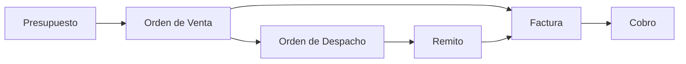

## Para qué sirve

El módulo de **Ventas** cubre el circuito comercial completo, desde el presupuesto hasta el cobro, pasando por la orden de venta, el remito y la factura.

## Circuito

## Documentos

| Documento | Categoría | Para qué |
|---|---|---|
| **Presupuesto** | `QUOTE` | Oferta al cliente, con validez. |
| **Orden de Venta** | `ORDER` | Compromiso de venta; dispara preparación y despacho. |
| **Orden de Despacho** | (logística) | Planificación del envío. |
| **Remito** | `REMITO` | Entrega de mercadería. |
| **Factura** | `INVOICE` | Comprobante fiscal. |
| **Nota de Crédito / Débito** | `CREDIT_NOTE` / `DEBIT_NOTE` | Ajustes sobre facturas. |
| **Recibo** | `RECEIPT` | Constancia de cobro. |

## Páginas de esta sección

- [Presupuestos](/procesos/ventas/presupuestos/)
- [Crear una Orden de Venta](/procesos/ventas/crear-orden-de-venta/)
- [Remitos de venta](/procesos/ventas/remitos/)
- [Facturación](/procesos/ventas/facturacion/)
- [Cobros](/procesos/ventas/cobros/)
- [Mis ventas y reportes](/procesos/ventas/mis-ventas/)
- [Circuito de ventas](/procesos/ventas/circuito-de-ventas/) — configuración

## Permisos necesarios

:::note[Permisos necesarios]
- Ver ventas · Crear ventas · Editar ventas · Confirmar ventas · Anular ventas · Eliminar ventas
- Además existen permisos por tipo de documento (presupuestos, órdenes de venta, facturas, remitos, notas de crédito/débito), que permiten un control más fino.
:::

## Ver también

- [Contrapartes](/configuracion/contrapartes/) — clientes.
- [Productos](/configuracion/productos/) — precios.
- [Secuencias y tipos de documento](/configuracion/documentos/).
